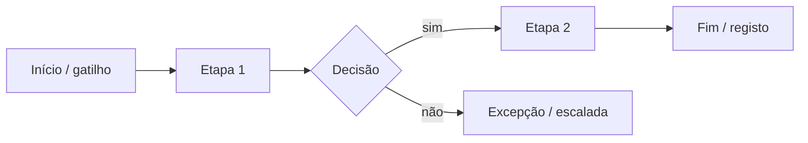

# {{TITLE}}

| Código | {{CODE}} | Versão | {{VERSION}} | Dono do processo | {{OWNER}} |
|---|---|---|---|---|---|

## 1. Finalidade e objectivos
O processo existe para [valor para o negócio]. Objectivos mensuráveis: [obj. 1], [obj. 2].

## 2. Âmbito, entradas e saídas (SIPOC)
| Fornecedores | Entradas | Processo (etapas) | Saídas | Clientes |
|---|---|---|---|---|
| | | 1. … 2. … 3. … | | |

## 3. Referências
{{REQUIREMENTS}}

## 4. Fluxo

## 5. Etapas, responsáveis e controlos
| Etapa | Descrição | Responsável | Controlo associado | Evidência |
|---|---|---|---|---|
| 1 | | | | |

## 6. Interfaces com outros processos
[Gestão de incidentes, gestão de alterações, gestão de fornecedores, RH …]

## 7. Indicadores do processo
| KPI | Fórmula | Meta | Frequência | Fonte |
|---|---|---|---|---|

## 8. Riscos do processo e controlos
| Risco | Controlo | Owner |
|---|---|---|

## 9. Melhoria contínua
Revisão do processo em revisão pela gestão; acções corretivas registadas como tarefas.

## Anexo A — Matriz requisito → etapa
{{REQUIREMENT_MATRIX}}
